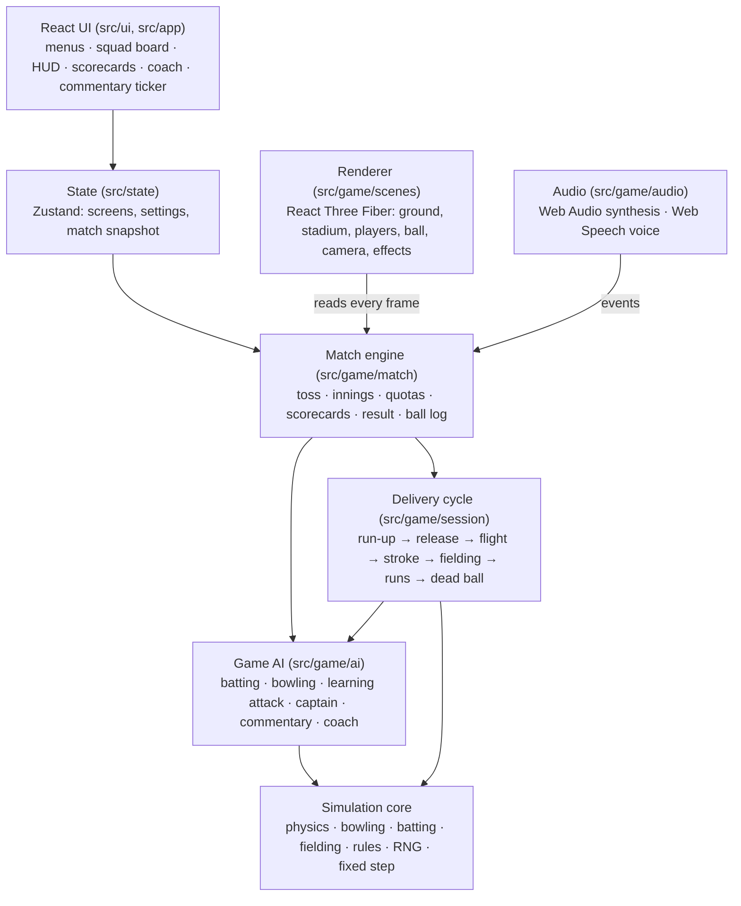
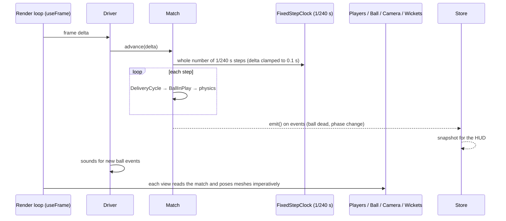
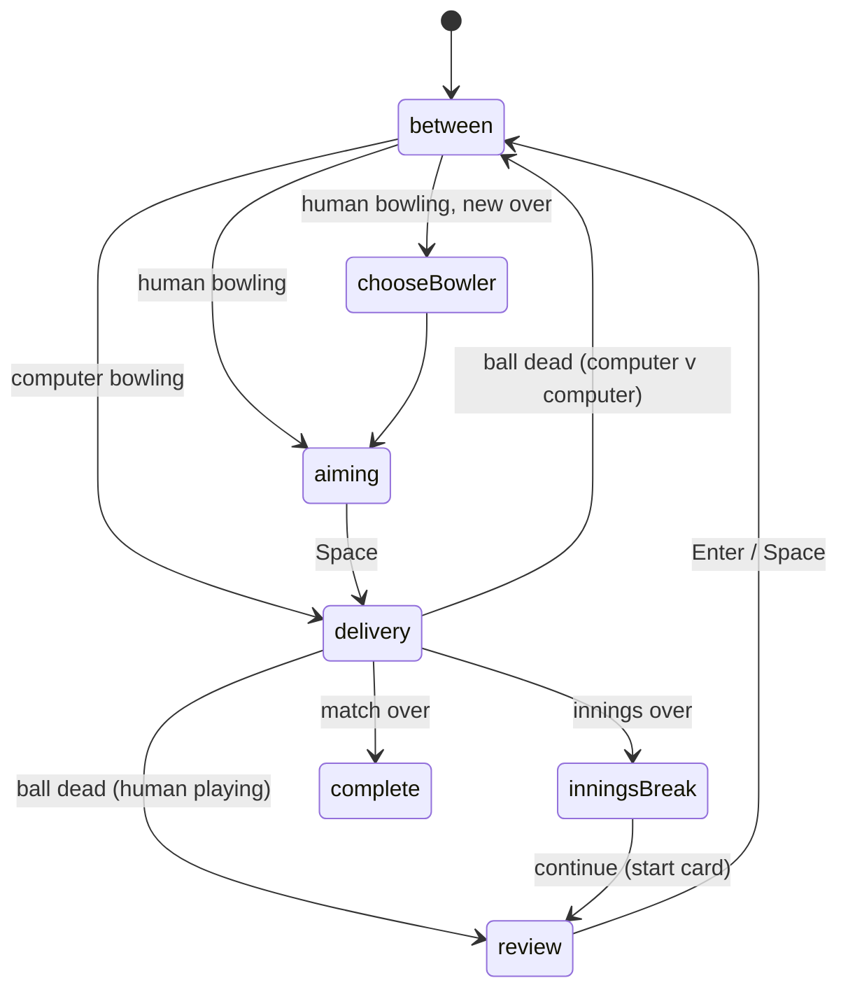
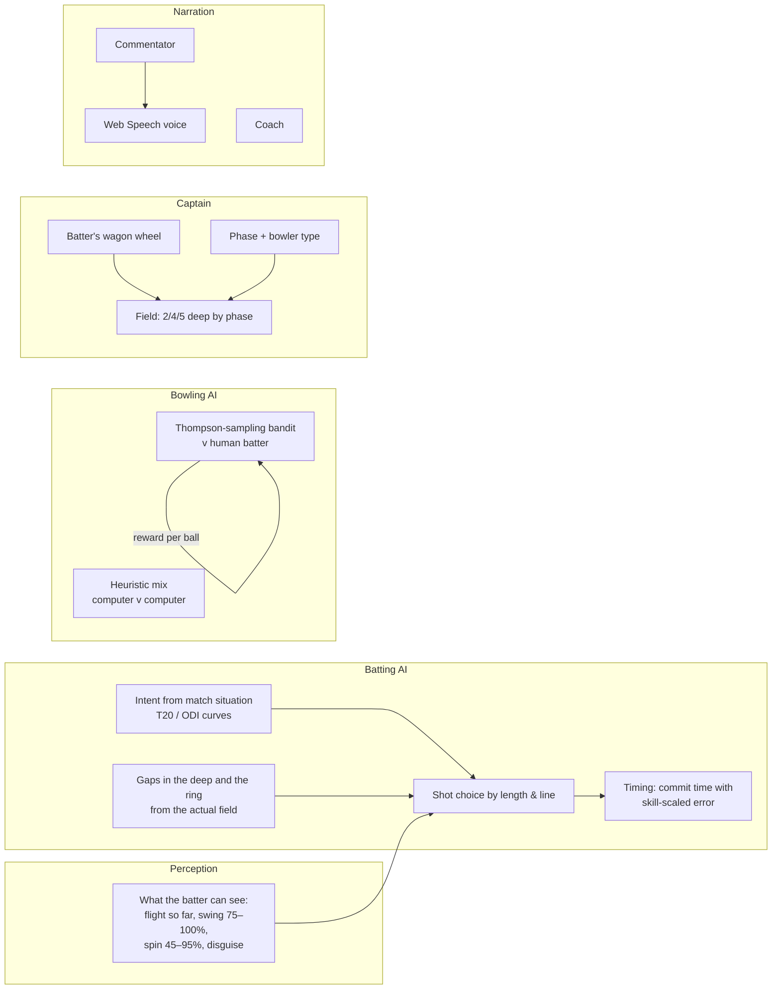
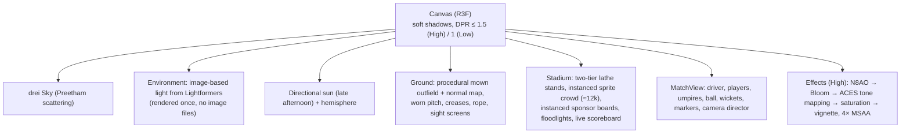
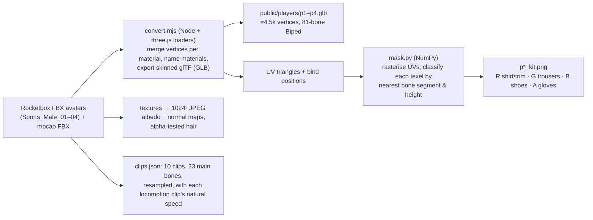
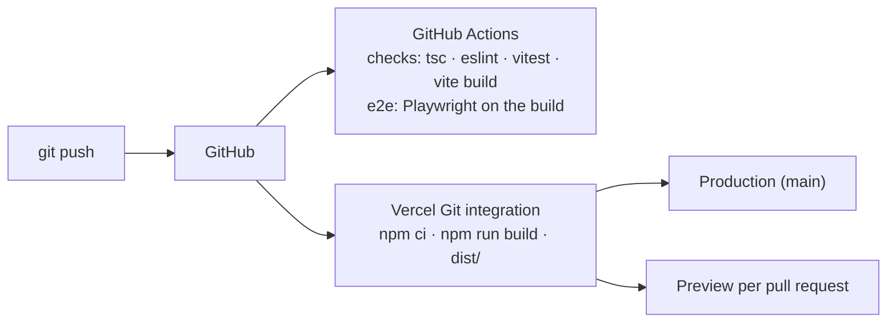

# Crease — Technical Architecture

**A browser-based 3D cricket game: how it is built, why it is built that way, and where it goes next.**

| | |
| --- | --- |
| Version | 0.8.0 (October 2026) |
| Repository | https://github.com/anand1296/Crease |
| Hosting | Vercel (static site, Git-integrated: every push to `main` deploys; pull requests get previews) |
| Stack | TypeScript (strict) · React 19 · Three.js r180 via React Three Fiber 9 · Vite 7 · Zustand 5 · Vitest 3 · Playwright |
| Size | ≈13,400 lines of application TypeScript, ≈1,800 lines of unit and simulation tests (136 tests), 3 browser tests |
| Backend | None. Everything — physics, AI, commentary, audio — runs in the player's browser |

Companion documents: [README](../README.md) (running and playing), [GAME_DESIGN](../GAME_DESIGN.md) (rules and the simulation's numbers), [ARCHITECTURE](../ARCHITECTURE.md) (module summary), [CHANGELOG](../CHANGELOG.md), [batting report](batting-report.md).

---

## Contents

1. [What Crease is](#1-what-crease-is)
2. [How it was built](#2-how-it-was-built)
3. [Technology decisions](#3-technology-decisions)
4. [System architecture](#4-system-architecture)
5. [The simulation](#5-the-simulation)
6. [The match engine](#6-the-match-engine)
7. [Game AI](#7-game-ai)
8. [Rendering](#8-rendering)
9. [Players: models, kits and animation](#9-players-models-kits-and-animation)
10. [Camera direction](#10-camera-direction)
11. [Audio and voice](#11-audio-and-voice)
12. [UI, state and input](#12-ui-state-and-input)
13. [Data: teams and squads](#13-data-teams-and-squads)
14. [Testing and quality](#14-testing-and-quality)
15. [Build, deployment and security](#15-build-deployment-and-security)
16. [Repository layout](#16-repository-layout)
17. [Feature inventory](#17-feature-inventory)
18. [Known limitations](#18-known-limitations)
19. [Future scope](#19-future-scope)
20. [Use of AI in building Crease](#20-use-of-ai-in-building-crease)

---

## 1. What Crease is

Crease is a limited-overs cricket game in the spirit of EA Sports Cricket 07: you pick a national side (India, Pakistan, Australia or England, with their current T20I squads), choose your XI and batting order, set the overs, difficulty and pitch, toss, and play a full match — batting with timing-based strokes and bowling with a delivery menu, a target and an accuracy meter — against a computer side that adapts to you.

What makes it more than an arcade game is that **every ball is simulated physically**: the ball swings, seams and turns according to the bowler and the pitch; the bat meets the *real* ball (not the one the batter thought was coming) through an impulse model; fielders run, dive and throw on physically planned paths; and every decision the computer makes is limited by what a player could actually perceive. The presentation layer — skinned, motion-captured players, a broadcast camera, post-processed rendering, synthesised sound and commentary — only ever *shows* what the simulation decided.

## 2. How it was built

### Phases

Crease was built in vertical slices, each of which was playable, tested, documented and deployed before the next began.

| Version | Date | Scope |
| --- | --- | --- |
| P0 | 21 Oct 2026 | Repository, Vite + React + TypeScript (strict) foundation, seeded RNG, fixed-step clock, ball-physics core, 3D ground, CI (GitHub Actions) and Vercel deployment |
| P1a–c | 21 Oct 2026 | Delivery engine (12 types, swing/seam/spin, pitch presets, launch solver); batting contact model (16 strokes, timing, edges); fielding plan (interception, catches, run decisions) |
| P1 (0.2.0) | 21 Oct 2026 | Playable practice innings: bat or bowl, HUD, perception-limited AI opposition |
| 0.3.0 | 21 Oct 2026 | Full matches (toss, two innings, targets, results, scorecards), LBW, wides, called running and run-outs, bowler quotas; squads and XI selection; menus; articulated players; stadium; synthesised sound |
| 0.4.0 | 22 Oct 2026 | Realism pass: skinned, motion-captured player models; classic and broadcast camera directors; physical sky, image-based lighting, post-processing; umpires; breakable stumps; physically modelled bat-on-ball sound |
| 0.5.0 | 22 Oct 2026 | Real squads (India, Pakistan, Australia, England), national kits with clash rule, T20 batting AI |
| 0.6.0 | 22 Oct 2026 | Game AI: learning bowling attack, AI captain with fielding restrictions, field-aware T20 batting, spoken commentary, coach |

### Working method

- **Simulation first, presentation second.** Each subsystem (ball, delivery, contact, fielding, match) was written as plain TypeScript, tested headless in Node, and calibrated against cricket numbers *before* anything was drawn. The renderer was then written to read the simulation, never to write it.
- **Calibrate with numbers, not impressions.** Computer-v-computer matches are run in tests and checked against real-world rates (runs per over, balls per wicket, dismissal mix). When a change moved those numbers (for example, the AI captain putting fielders on the boundary), the change was not finished until the numbers were back in range.
- **Verify in a real browser.** Every visual change was checked by driving the production build in headless Chromium (software WebGL) and reviewing screenshots of the actual frames — run-up, release, shot, chase camera, wicket — not just by reading code.
- **Ship every phase.** Each phase ended with type check, lint, unit tests, browser tests, documentation, a commit and a deploy.

## 3. Technology decisions

| Area | Choice | Alternatives considered | Why |
| --- | --- | --- | --- |
| Language | TypeScript, `strict`, `exactOptionalPropertyTypes`, no `any`, no non-null assertions | JavaScript | The simulation has hundreds of numeric parameters and many optional fields (a ball may or may not have pitched, been struck, been caught). Strict types catch whole classes of bugs before a test runs. |
| 3D engine | **Three.js** (r180) | Babylon.js, PlayCanvas, Unity/Godot WebGL export, raw WebGPU | The most widely used web 3D engine, with the largest ecosystem (loaders, post-processing, skinning utilities). Babylon is comparable in capability but would not add realism here; Unity/Godot exports are tens of MB, slow to start and awkward to integrate with a React UI. WebGPU (via Three's `WebGPURenderer`) is the planned next step once the post-processing chain is ported — see [future scope](#19-future-scope). |
| Scene integration | **React Three Fiber** 9 + drei | Imperative Three.js | Declarative scene composition and Suspense-based asset loading, while hot paths (posing 24 skeletons, moving the ball) stay imperative in `useFrame` — no React re-render per frame. |
| Post-processing | **pmndrs `postprocessing`** + `@react-three/postprocessing` (N8AO, Bloom, ToneMapping, HueSaturation, Vignette) | Three's own `EffectComposer` | Merges effects into few passes (faster), and includes N8AO, one of the best real-time screen-space AO implementations for the web. |
| UI | **React 19** (DOM over the canvas) | UI drawn in WebGL | Menus, scorecards and the squad board are text- and table-heavy; the DOM gives accessible, crisp, responsive UI for free. |
| State | **Zustand** 5 | Redux, React context | The match lives *outside* React (a class advanced by the render loop); the store only holds screens, settings and a snapshot of the match refreshed on match events. Zustand is tiny and lets the render loop read state without subscribing. |
| Build | **Vite** 7 | webpack, Parcel | Fast dev server; code-splits Three.js and R3F into their own cached chunks; the 3D canvas is lazy-loaded so the page paints first. |
| Unit tests | **Vitest** 3 | Jest | Same transform as Vite (TypeScript with no extra config), fast enough to run full computer-v-computer matches in the suite. |
| Browser tests | **Playwright** with Chromium and SwiftShader | Cypress | Runs WebGL on GPU-less CI machines (software renderer) and drives the real game with the keyboard. |
| Hosting | **Vercel** (static), GitHub Actions CI | Netlify, GitHub Pages | Git integration with preview deployments per pull request; static hosting needs no server. |
| Audio | **Web Audio API, synthesised** | Recorded samples | No licensing, no downloads, and — for the bat — sound that follows the physics of the actual contact (see [§11](#11-audio-and-voice)). |
| Voice | **Web Speech API** (`speechSynthesis`) | Recorded commentary, cloud TTS | Built into every major browser; no keys, no network, no cost. |
| Player models | **Microsoft Rocketbox** avatars (MIT) + Rocketbox motion capture | Mixamo, procedural primitives, custom modelling | Realistic, rigged, permissively licensed humans with a standard Biped skeleton and matching mocap clips. Mixamo's terms make redistributing raw assets in a public repository unclear; procedural primitives (used until 0.3.0) could not look realistic. |
| Backend | **None** | Node API, serverless functions | A single-player game with deterministic simulation needs no server. Keeping it static means free hosting, no secrets, strict CSP and offline-capable play. Server-side features (LLM commentary, multiplayer) are designed as optional additions — see [future scope](#19-future-scope). |

## 4. System architecture

### Layers



**The dependency rule:** nothing under `core`, `physics`, `bowling`, `batting`, `fielding`, `simulation`, `session`, `match`, `ai` or `data` imports React or Three.js. The whole game can therefore be played headless in Node — which is exactly what the tests do.

### The frame loop

There is one loop: React Three Fiber's `requestAnimationFrame`.



- The simulation advances in fixed 1/240 s steps regardless of frame rate; rendering interpolates the ball between the last two steps. Results are identical at 30, 60 or 144 fps.
- Frame deltas above 0.1 s are clamped: a stalled tab pauses the game rather than fast-forwarding it.
- The game pauses itself when the window loses focus.
- Behind the match setup, squad and pause screens the canvas switches from `frameloop="always"` to `"demand"`: one last frame is drawn and kept, and nothing is rendered until play resumes, so the menus have the main thread and the GPU to themselves.

### Performance: what stalls a WebGL game, and what Crease does about it

Profiled with Chrome's CPU profiler, Long Animation Frame and Event Timing entries in headless Chromium. Per-frame JavaScript (simulation, AI, posing 24 skinned players) is a few milliseconds; the stalls were elsewhere:

| Stall | Cause | Fix |
| --- | --- | --- |
| Freezes the first time something appears (ball in flight, broken wicket, replay) | WebGL compiles a material's program on first draw; three.js then reads the compile log synchronously. On Windows (ANGLE → Direct3D) one program can take hundreds of ms | `scenes/warmup.ts`: after a match is built, upload every texture (`initTexture`), compile every material with `compileAsync` (KHR_parallel_shader_compile), with hidden objects made visible for the synchronous parts and the post-processing target bound so the right program variants are built, then render one frame to build the shadow depth programs. A loading screen covers it. `checkShaderErrors` is off in production. An e2e test asserts the program count doesn't change during play |
| ≈165 ms hitch on every boundary, wicket and catch | The crowd roar was synthesised sample by sample on the main thread | Four reactions pre-rendered by a generator in `requestIdleCallback` slices after audio starts; reused with a slight pitch change |
| First click ≈115 ms; Start button slow to respond | Audio context and reverb built inside the click; the match (squads, AI, 24 skinned clones) built inside the Start handler | Audio context created after the next paint, buffers in idle time; Start shows the loading screen first and builds the match once it has painted |
| Menus sluggish over the live stadium | Every DOM update waited behind a full 3D frame | On-demand rendering behind menus and pause |
| Low frame rate on modest GPUs | Fill rate: up to 1.5× resolution, 4× MSAA, ambient occlusion | `FrameBudget` / `adaptiveQuality.ts`: median frame time over 90 frames; slower than 45 fps → pixel ratio steps 1 → 0.85 → 0.72 → 0.6 and (level 2) ambient occlusion off by disabling its pass (removing it would rebuild and recompile the effect chain); one step back up after a smooth spell, never again if that fails. Unit-tested |
| Key indicator a frame late; bowling panel re-rendered every frame | Polled with `requestAnimationFrame`; meter value through React state | Keyboard notifies the indicator inside the key event; the needle is moved directly through a store subscription |

### Determinism

A match seed drives everything. Every ball gets its own forked RNG stream (`sfc32`), and within it the delivery, the batter's perception, the stroke, the fielding and each AI decision get their own forks. Adding a random draw to one system therefore never perturbs another, and any match can be replayed exactly — the basis for reproducible tests and, later, replays.

## 5. The simulation

Full parameters are in [GAME_DESIGN.md](../GAME_DESIGN.md); this is the architecture.

### Ball physics (`physics/ball.ts`)

Semi-implicit Euler at 240 Hz with gravity, quadratic air drag (Cd 0.45), swing as a lateral acceleration until the first bounce, spin drift and topspin dip in the air, and at the bounce: restitution with per-delivery variation, **Coulomb friction** (horizontal speed lost ∝ μ·(1+e)·vertical impact speed — a steep bouncer loses more pace than a skidding yorker), seam deviation and turn scaled by the pitch preset. Bounces are resolved at the exact sub-step contact point (no tunnelling, exact pitch maps). Rolling deceleration is speed-dependent. Four pitch presets (Balanced, Green top, Dry turner, Flat deck) are sets of physical multipliers.

### Bowling (`bowling/`)

A delivery is a **plan** (type, line or landing spot, length, side of the wicket, amount of swing/cut/spin, effort) and an **execution**. Sixteen delivery types are physical recipes; cutters deviate off the pitch in a chosen direction. The human bowls in three steps — choose the delivery (and amount, side and field preset), place and lock the landing marker, then lock the pace on a meter during the run-up while still varying the amount — and the ball is aimed at the marker with intended swing included. Effort trades pace for control; the run-up length comes from the bowler's style (`runUp.ts`), shared by simulation and renderer. The bowler aims using the movement they *intend*; a **shooting-method solver** finds the launch velocity (with drag and swing) that pitches the ball on the aiming point; then the ball gets the movement it *actually* has — swing ±30%, uncontrollable seam, spin ±15%, bounce variation, and line/length/speed error scaled by accuracy, delivery difficulty, fatigue and release quality (the human's accuracy meter, or the computer's execution roll). Fatigue builds per ball and recovers between overs.

### Batting (`batting/`, `simulation/ballInPlay.ts`)

The player commits with a key press; the bat arrives `swingTime` later (0.14–0.30 s by stroke). Three ideas make it a skill game rather than a dice roll:

1. **Timing tolerance is a distance along the ball's path**, so the time window shrinks with pace.
2. **The bat's line is set from what the batter could see at the moment of commitment** — the flight so far, swing read at 75–100%, spin at 45–95% by technique, a googly or doosra read as the stock ball unless picked; seam and uneven bounce cannot be anticipated. Late correction after the bounce is possible only with time. Edges and plays-and-misses come out of this naturally.
3. **Contact is physics**: contact quality from normalised timing and position errors; where on the bat (across the face → edges; along the blade → splice or toe); then an impulse collision of the *real* ball with the moving bat face. The same keys against different deliveries give different trajectories.

LBW is judged per Law 36 (pitched outside leg, impact outside the line, otherwise project the ball on with the same physics: hitting, missing or going over).

### Fielding and running (`fielding/plan.ts`, `session/deliveryCycle.ts`)

When the ball is struck, its path is projected with the real physics. Each fielder has a reaction time and accelerates (6 m/s²) to a top speed by attribute, reaching the ball standing or diving. The first fielder able to intercept takes it (nobody dives at a ball they could walk in and collect). Catches succeed with a probability that falls with difficulty (dive, time to settle, pace, height). Throws travel at 20–32 m/s. The human calls each run; the batters set off and a run-out happens if the throw beats them. The computer runs only what is safe.

## 6. The match engine

`match/match.ts` is a plain class that owns a `FixedStepClock`, the innings, scorecards and the current `DeliveryCycle`. It implements: overs of six legal balls; wides (by line and height) and no-balls (re-bowled, one extra); bowled, caught, LBW and run out; strike rotation; the new batter on strike after a catch; bowler quotas (`ceil(overs/5)`), no consecutive overs, the keeper can't bowl; innings end on overs, all out or target; results ("won by N runs", "won by N wickets (M balls left)", tie).



**Review and pacing.** When a human is involved, every dead ball goes to `review` rather than straight to the next ball. The review says what to show: a *ball* prompt (Next ball), an *over* summary (bowler's figures, the over's balls and runs), a *wicket* card (the batting card, fall of wicket, partnership, next batter, plus the over summary if the wicket ended it) or the *start* card. The match only leaves `review` on `next()`, which the Enter/Space handler calls. The match also holds a `speed` factor: `advance(dt)` feeds `dt × speed` to the fixed-step clock, so slowing the game changes nothing but the wall-clock rate — the same seed gives the same match at every speed (a unit test checks it). The captain's field is cached per over, striker and bowler so fielders don't shuffle every ball.

Inside `delivery`, the `DeliveryCycle` runs `runUp → inFlight → struck → dead`, raising events (`bounce`, `contact`, `pad`, `stumps`, `boundary`, …) that the renderer and audio consume. Every recorded ball also goes into a **ball log** (for the coach), the **learning attack's** reward update, and the **commentator**.

## 7. Game AI

All game AI runs in the browser, deterministically, with no network calls.



### 7.1 Computer batter (`ai/battingAi.ts`)

- **No omniscience.** It judges the ball after 0.14 s of flight with errors in line and length that grow with lower technique and higher difficulty; it cannot see seam movement before the bounce; a slower ball or a wrong'un can fool it. Its stroke then goes through exactly the same contact physics as the human's.
- **Situational intent.** Intent rises with the required rate or as the overs run out and falls with wickets. In games of 20 overs or fewer it follows a T20 curve (positive from ball one, all-out at the death); above ordinary aggression it lofts good-length balls and hooks.
- **Reads the field.** It computes the widest angular gap between boundary fielders on each side, and between ring fielders, from the actual field positions, and aims lofted shots and pushes into them.
- **Calibration.** Computer-v-computer T20s with the real squads, against the AI captain's fields, average about 185 in the first innings at about 9.3 runs an over with around five wickets down — high-scoring modern T20I territory. A test holds the first-innings average to 130–230 and 7–11.5 an over. Fifty-over games come out at about 4.3 an over with a wicket every 31 balls (traditional rather than modern ODI scoring), held to 3.5–7 an over and 20–60 balls a wicket by a second test.
- **A calibration bug found while writing this document**: one-day games had been collapsing (under 3 an over, a wicket every 19 balls) because a fractionally late *defensive* stroke let the ball reach the pad before the bat. Defensive strokes are now presented early and adjust better to movement off the pitch, as real defensive technique does — see [GAME_DESIGN](../GAME_DESIGN.md#strokes).

### 7.2 Learning bowling attack (`ai/adaptiveBowling.ts`)

Against a human batter the computer bowls **plans** — pace: good length at the stumps, the corridor, full outswingers, inswingers, back of a length, bouncer, yorker, wide yorker, slower ball full, slower bouncer; spin: stock at the stumps, turning away, flight, flatter and quicker, the variation.

Choosing a plan is a **multi-armed bandit solved by Thompson sampling**:

- **Reward** per ball (fielding side's view): −(runs + extras), +0.6 for a dot, +0.5 for beating the bat, +18 for a wicket; clamped to [−7, 18].
- **Belief** per plan: Gaussian mean with per-ball σ 3.2, from a **phase-aware prior** worth four balls (yorkers and slower balls good at the death; swing and good length in the powerplay; bouncers a surprise weapon).
- **Pooling**: the whole batting line-up is the same human, so each plan's team-wide record counts at half weight towards each batter's belief; a batter's own record counts fully.
- **Choice**: sample a mean from every plan's belief, bowl the best sample. Sample width 1.6 − 0.9 × difficulty "tactics": Easy explores, Hard exploits quickly.
- **Explanation**: when the attack is exploiting a plan that has worked (≥3 balls, clearly above average), it produces an insight ("yorkers at the stumps — Brook has struggled against those") that the commentator uses.

Tests show it learns: against a batter who is dismissed by bouncers and hits everything else, the bouncer share rises to over 60% of balls; with no data it already bowls ≥1.5× more yorkers at the death than in the powerplay.

### 7.3 AI captain (`ai/captain.ts`)

Each ball, the captain places nine fielders (plus the keeper and bowler) from 18 candidate positions:

- **Fielding restrictions**: at most two outside the 30-yard circle in the powerplay (first 30% of a T20's overs), four in the middle, five at the death (last 20%).
- **Base values** per position by bowler type and phase (slips and gully for the new ball; long-on, long-off and deep midwicket for spin and the death).
- **The batter's wagon wheel**: each of this batter's scoring shots adds value to positions near its direction — boundaries to the deep, singles and twos to the ring — with recent shots weighted more.
- **Selection**: best deep positions allowed (≥30° apart), then the ring (≥20° apart); close catchers get the best hands. When the batter has scored ≥35% of their runs in one region, the captain "protects" it, and the commentator mentions the field change.

### 7.4 Commentary (`ai/commentary.ts`, `audio/voice.ts`)

A **template grammar over facts**: bowler and batter (surnames), delivery and its speed, stroke and region (derived from the batter-relative exit direction and elevation — "through the covers", "over deep midwicket", "down to third man"), fielder, dismissal type, the out batter's score, the bowler's haul, milestones (fifty, hundred), the over's runs or a maiden, the chase equation, the bowlers' plan, field changes, innings and match summaries. Phrasing is chosen by a seeded RNG and never repeated twice running. Lines are shown in a ticker and spoken by the browser's **Web Speech API**, preferring an English (UK, India, Australia) voice, faster and higher-pitched for big moments, interrupted by the next ball. Toggle with <kbd>V</kbd>.

### 7.5 Coach (`ai/coach.ts`)

Rules over the match's ball log, shown at the innings break and the result:

- **Timing**: mean timing error beyond ±18 ms → "You are early — by about 32 ms", with a note for the slower ball or 140 km/h+ pace.
- **Nemesis delivery**: the type with the highest trouble score ((4 × dismissals + plays-and-misses)/balls − runs per ball / 3) and how to play it *with this game's controls*.
- **Shot selection**: front-foot drives to short balls; leaving balls that hit the stumps.
- **Strength**: the most productive stroke ("…expect the captain to put a fielder there").
- **Bowling**: best and most expensive delivery by economy and wickets; wides.

### 7.6 Why no large language model in the client (yet)

LLM-generated commentary or coaching (for example with Claude) would be richer, but calling a hosted model from a public static page would expose an API key. The design for it is in [future scope](#19-future-scope): a small serverless proxy holding the key, rate-limited, with the deterministic commentator as the instant fallback. Everything described above works offline and costs nothing per player.

## 8. Rendering

### Scene



- **Everything environmental is procedural**: textures are drawn on canvases at load (outfield stripes and grain with a matching normal map; pitch grain, live grass, cracks and footmarks; stitched ball; sponsor boards; a 32-person spectator sprite sheet), so the only binary assets are the player models.
- **Draw calls are budgeted**: the crowd is one instanced mesh whose cheer animation runs in the vertex shader; sponsor boards are six instanced meshes; only the main body parts and equipment cast shadows.
- **Quality tiers**: *High* adds soft shadows, image-based lighting, the crowd, post-processing and high-DPI rendering; *Low* drops them. Low is chosen automatically when `WEBGL_debug_renderer_info` reports a software renderer (SwiftShader, llvmpipe), and the choice is persisted. Within a tier the resolution adapts to the frame rate (see [Performance](#performance-what-stalls-a-webgl-game-and-what-crease-does-about-it)).

## 9. Players: models, kits and animation

### Asset pipeline (offline, `scripts/avatars/`)



### Kits

The body material is a `MeshStandardMaterial` patched at compile time (`onBeforeCompile`): it samples the kit mask and replaces the albedo with the team's shirt, trim (collar and cuffs), trousers, shoe and glove colours, makes fabric rougher than skin, and multiplies skin and hair by a per-player tone. One avatar can therefore wear any team's kit, and the four avatars × five skin tones give variety across 24 people on the field. Equipment — helmet with grille, cap or sun hat, pads (vertical canes, knee roll, wings), keeper's mitts — is modelled procedurally and parented to bones using bind-pose transforms.

### Animation: motion capture plus a procedural control rig

Every player has a hidden **control rig** (`Humanoid.tsx`, sized to the avatar's measured proportions) that the procedural motion library poses — batting stance, backlift, stroke and follow-through timed to the simulated contact; the bowling actions (keyframed tracks per action — pace, medium, off-spin, leg-spin — against time from release: bound, back-foot contact side-on, the arm turning backwards-over a full circle to release just past vertical with the front leg braced, follow-through across the body; unit tests check the arm never turns the wrong way and is high at release, and the hand is measured to be within a few centimetres of the physics' release point); the keeper's crouch; fielders' ready position, gather and throw; umpire signals. `AvatarRig` then drives the visible skeleton from one of two sources, cross-fading over 0.25 s when the source changes:

- The ball is held in the bowler's measured hand until release, then eased onto the physics' path over 70 ms. Its seam is a raised ring: for pace it is upright and steady (the ball backspins about the seam's axis), angled by the swing; for spin the ball turns about the real spin axis (top spin about x, side spin along the flight) with the seam set at an angle to it, so the seam visibly rotates.
- **Motion capture** for running, jogging, walking (clip chosen by speed, advanced by distance actually covered so feet don't slide), idling, breathing and celebrating.
- **Retargeting** of the control rig: each limb bone gets a constant correction `R0` mapping its A-pose bind orientation to "hanging down" (the rig's zero pose), so its orientation is the rig segment's orientation × `R0`; the torso's rotation is shared over three vertebrae; the head is steadied and turned towards the ball (yaw-limited); arms holding the bat are solved with **two-bone IK on the model itself** (elbow pole from the rig) so the gloves land exactly on the handle; fingers curl to grip.

## 10. Camera direction

`scenes/camera/director.ts` is a pure function from the state of the ball to a shot, unit-tested like the simulation:

| When | Shot |
| --- | --- |
| Between balls | Wide, behind the bowler's arm (whole pitch and close field) |
| Human bowling, setting up the ball | **Aim**: high behind the bowler's arm, the whole pitch and the landing marker in frame; the run-up pushes in from here |
| Run-up | Slow push-in and zoom (smoothstep), arriving tight on the striker a beat before release; a slight hand-held drift |
| Ball left, missed or padded | Hold the tight frame |
| After the stroke | 0.45 s from the bowler's end, widening and panning with the ball |
| Ball beyond 12 m | **Cut** to a high camera on the far side of the boundary, square to the ball's path, framing ball and chasing fielder (field of view computed to fit both and the ball's height) |
| Stumps broken | **Cut** to a low stump camera |

The director has two styles. **Classic** (the default since 0.7.0) is Cricket 07's framing: the camera sits about 5 m up and 27 m behind the bowler's stumps with a 30° lens, and pushes in to 3.9 m up, 17 m back with a 19° lens — high enough that the line to the striker clears the umpire's hat. **TV** is the long-lens broadcast framing (46 m back, 15° → 9.5°). <kbd>C</kbd> cycles classic → broadcast → batter's view → high wide view.

**Action replays** (`scenes/replay.ts`). While a ball is live, every view writes what it drew into a per-frame record: the ball's position and visibility, every player's and umpire's pose (position, facing, limb angles, IK targets, the motion-capture clip and its time), both bats and the state of both sets of stumps. After a wicket or a boundary, the same views read frames back instead of the live match, at 0.45×, while the HUD shows a REPLAY badge. The window depends on the dismissal (from just before release to just after the stumps break for bowled and LBW; from before contact to after the catch, run-out or boundary otherwise), and so does the camera: square-on at the striker's stumps for bowled and LBW; behind the striker for the rest, rising with a lofted ball but aiming below it so the frame keeps the ground. Because it is a recording rather than a re-simulation, a replay always shows exactly what happened and costs only a few hundred numbers per frame. Enter skips; the setting is persisted.

## 11. Audio and voice

All synthesised in the browser (`audio/sound.ts`), through a gentle limiter and a synthetic **open-stadium reverb** (slap-back reflections off the stands at 70–190 ms and a short, darkening tail).

- **Bat on ball** is a small physical model rendered sample by sample for each contact: a ~1 ms half-sine contact pulse (longer and softer off-centre), the crack it radiates (the pulse's derivative), the blade's short woody ring (≈1–3 kHz modes, decaying in tens of milliseconds) weighted by the pulse's spectrum, and the bat's **bending modes** (≈142 / 465 / 705 Hz, after Russell's measurements of wooden bats), excited by how far from the sweet spot the ball struck (`along`/`across` from the contact model). A middled drive is a short, bright crack (>60% of its energy at 0.8–4 kHz, gone in under 45 ms); a toe-ender is a dull, ringing thud; an edge is a thin tick. Unit tests check these spectral properties.
- **Other sounds**: bounce on pitch/outfield, pad, stumps and bails, ball into hands, and crowd reactions (formant-filtered voices plus applause made of individual claps) only when something happens. There is no continuous background bed.
- **Voice**: commentary through `speechSynthesis` (see [§7.4](#74-commentary-aicommentaryts-audiovoicets)).

## 12. UI, state and input

- **Match HUD**: a scoreboard bar along the bottom (score, overs, batters, bowler and this over's balls, run rate, the chase, powerplay); a **controls panel** that shows the batting or bowling keys at all times, lights the keys held or just pressed (polled each animation frame from the keyboard state) and names the stroke the current direction + key will play (the same `shotFromInput` the match uses); the *Next ball* prompt and the over and wicket cards; the REPLAY badge.
- **Screens**: main menu (over the live stadium, orbiting camera) → match setup (teams, overs 2/5/10/15/20, difficulty, pitch, toss/bat/bowl) → squad board (tick 11 of the squad, reorder, validation: exactly 11, warnings for no keeper, fewer than five bowlers, no spinner) → match (HUD) → innings break (scorecard, coach) → result (summary, top performers, both scorecards, coach, rematch).
- **Store**: `state/game.ts` (Zustand) holds the screen, setup, settings (sound, graphics, commentary — persisted in `localStorage`) and a **snapshot** of the match rebuilt on match events, so the HUD re-renders on events, not frames.
- **Input**: bindings are data (`input/keyboard.ts`); the handler reads the current match from the store. Batting: arrows for direction + D (ground), A (lofted), S (defend/push), W (sweep), X (leave), Shift (back foot), Space/R (run). Bowling: 1–9/Enter (choose bowler), Q/E (delivery), arrows (target), Space (run in, release on the meter). General: Enter/Space (next ball, continue, skip replay), P/Esc, C, M, V, H.
- **Accessibility basics**: DOM UI with roles and labels, visible focus, `prefers-reduced-motion` respected, captions for every spoken line (the ticker).

## 13. Data: teams and squads

`data/teams.ts` holds India, Pakistan, Australia and England with each board's most recently announced men's T20I squad as of October 2026 (India and Pakistan named 6 October, England 13 October; Australia's squad for Bangladesh, June 2026). Names, batting hands, bowling styles (left-arm orthodox and wrist spin modelled as mirrored finger and wrist spin), captains and keepers are factual; **the numeric ratings are the game's own approximations**. Kits use national colours only — no badges, logos or kit-maker marks — and when two kits clash (India and England are both blue) the away side wears its alternate strip. The original fictional sides live on in `sampleTeams.ts` as fixtures for the physics tests, whose expectations depend on their exact ratings.

## 14. Testing and quality

| Layer | What | Where |
| --- | --- | --- |
| Static | `tsc --noEmit` (strict), ESLint (typescript-eslint strict, React hooks; no `any`, no non-null assertions) | CI `checks` job |
| Physics | Drag, bounce friction, sub-step bounce accuracy, rolling, pitch effects | `physics/ball.test.ts` |
| Bowling | Solver accuracy, swing/seam/turn direction by arm, error scaling, yorker/bouncer lengths | `bowling/execute.test.ts` |
| Batting | Acceptance behaviours (a well-timed drive goes along the ground through the covers; late opens the face; edges; yorkers are hard), distributions | `batting/batting.test.ts`, [batting report](batting-report.md) |
| Fielding | Interception, catches, tie-breaks, run safety | `fielding/plan.test.ts` |
| Match | Whole computer-v-computer matches: scorecards add up, quotas, no consecutive overs, chases stop at the target, determinism | `match/match.test.ts` |
| Calibration | Real squads at T20 and one-day rates | `match/t20.test.ts` |
| AI | Learning attack converges on what works; phase priors; pooling; captain restrictions and wagon-wheel response; gap reading; commentary facts and variety; coach findings | `ai/ai.test.ts` |
| Presentation logic | Camera director shots and cuts; bat-sound spectra and decay | `scenes/camera/director.test.ts`, `audio/sound.test.ts` |
| Data | Squads complete, captain and keeper in the default XI, kit clash rule | `data/teams.test.ts` |
| Browser | Boot without console errors; menus → setup → squad changes → batting strokes timed to the live ball → runs → pause freezes the simulation → quit; bowling with bowler choice, delivery, aim and release | `e2e/*.spec.ts` (Playwright, Chromium + SwiftShader) |

Browser tests observe the game through a small read-only debug surface (`window.__crease`: ball position, phase, ETA to the batter, score, simulation steps). CI runs the checks job (type check, lint, unit tests, build) and then the e2e job against the built artefact on every push and pull request.

## 15. Build, deployment and security



- **Bundles**: the 3D code is lazy-loaded after the shell paints. Gzipped: app ≈43 kB, scene ≈138 kB, React Three Fiber ≈151 kB, Three.js ≈182 kB. Player assets ≈4.5 MB (four GLBs, textures, clips), fetched during the menus.
- **Caching**: hashed `/assets/*` are immutable for a year; `index.html` is never cached.
- **Security headers** (`vercel.json`): a strict Content-Security-Policy (`default-src 'self'`, same-origin scripts only, no inline scripts, no third-party connections, `frame-ancestors 'none'`), HSTS, `X-Frame-Options: DENY`, `nosniff`, a strict referrer policy. The game makes no network requests beyond its own static files; no cookies, no analytics, no personal data.
- **Any static host** works: `npm run build` and upload `dist/`.

## 16. Repository layout

```
src/
  app/            App shell, error boundary, global styles
  ui/             Menus, squad board, HUD, scorecards, coach and commentary UI
  state/          Zustand store (screens, setup, settings, match snapshot)
  game/
    core/         Seeded RNG, fixed-step clock, vector helpers
    physics/      Ball flight, bounce, rolling
    bowling/      Delivery types, launch solver, execution, fatigue
    batting/      Strokes, contact model, body geometry, test harness
    fielding/     Interception planning, catches, run safety
    simulation/   One delivery from release to dead ball (BallInPlay), LBW
    session/      DeliveryCycle: run-up, fielders, running, outcome
    match/        Match engine, squads and XI validation
    ai/           Batting, bowling, learning attack, captain, commentary, coach
    data/         Field, pitches, field positions, teams (+ test fixtures)
    model/        Player and difficulty types
    input/        Keyboard bindings and controls
    audio/        Synthesised sound, commentary voice
    scenes/       R3F scene: ground, stadium, match view, effects
      rig/        Control rig, motion library, skinned cricketer, retargeting, assets
      camera/     Broadcast director
public/players/   Avatar GLBs, textures, kit masks, clips (Rocketbox, MIT)
scripts/avatars/  Offline avatar conversion and kit-mask baking
e2e/              Playwright browser tests
docs/             This document, batting report
```

## 17. Feature inventory

**Cricket**: limited-overs matches of 2–20 overs a side (the engine also plays one-day games); toss; two innings; targets and results; full scorecards with fall of wickets, extras, maidens and economy; bowled, caught, LBW (Law 36 projection), run out; wides and no-balls; called running; bowler quotas and no consecutive overs; fatigue; four pitch types; three difficulty levels; fielding restrictions.

**Batting**: 16 strokes plus the push, front/back foot, timing measured in milliseconds, edges, plays-and-misses, perception-limited bat line, physics contact.

**Bowling**: 12 delivery types by style (pace and both spin types, either arm), line/length target, accuracy meter, bowler choice per over.

**Teams**: India, Pakistan, Australia, England with current T20I squads; XI and batting-order selection; captains and keepers; national kits with clash rule.

**AI**: perception-limited batting with situational and T20 intent and field reading; learning bowling attack; AI captain; commentary; coach.

**Match flow**: a wait for the player after every ball; over-summary and wicket cards with the scorecard; game speed (0.65× / 0.8× / 1×); action replays of wickets and boundaries; an always-visible controls panel.

**Presentation**: skinned, motion-captured players with kits and equipment; umpires with signals; breakable stumps; broadcast camera director; physical sky, image-based lighting, soft shadows, ambient occlusion, bloom, filmic tone mapping; procedural ground and stadium; sprite crowd that reacts; synthesised, physically modelled sound; spoken commentary; quality tiers.

## 18. Known limitations

- Controls follow Cricket 07's scheme in spirit, not key for key. Keyboard only — no gamepad or touch yet, so phones can't play.
- Strokes, the bowling action and fielding are procedural motions retargeted onto the models, not motion-captured cricket; four body models are shared across all players; faces are generic.
- No byes, leg byes or overthrows; no DRS; no free hit after a no-ball; a called run can't be sent back.
- Ball physics was not changed in 0.7.0; the ball is drawn 1.35× life size for visibility.
- Real-GPU frame rate hasn't been profiled across devices (adaptive resolution keeps it up on modest GPUs); on software renderers even Low graphics is slow. A resolution step costs one resize (a few ms on a GPU).
- One-day scoring (≈4.3 an over) is below modern ODI rates (≈5.8); the one-day batting curve needs more tuning.
- Squads reflect each board's latest announcement as of October 2026 and will date; ratings are approximations.
- Player names are used for a non-commercial project; a commercial release would need player and board licences.

## 19. Future scope

**Near term**
- **Gamepad** (Gamepad API: stick for direction, face buttons for strokes, triggers for back foot/run) and **touch controls** with a landscape mobile layout.
- **Performance**: profile on real GPUs; level-of-detail avatars for distant fielders; GPU skinning budget; adaptive resolution.
- **Replays and highlights** — the deterministic simulation makes exact replays cheap (re-run the seed); a Hawk-Eye-style ball-tracking overlay for LBWs from the already-computed projection.
- **Captaincy controls** for the human: set your own field (presets and drag-to-place), bowling changes, aggression slider.
- **Rules**: byes and leg byes, overthrows, free hit, DRS reviews.

**AI**
- **LLM commentary and coaching (bring-your-own or hosted)**: a serverless function (e.g. Vercel Functions) holding an Anthropic API key, called with the structured ball facts the commentator already produces; prompt-cached persona and style; rate-limited; the deterministic commentator remains the instant offline fallback and the source of truth for facts (the model writes colour, never decides outcomes). The same endpoint could power a conversational coach ("why do I keep getting out to the googly?").
- **Learned batting AI**: train shot selection with reinforcement learning against the simulation itself (it runs headless at many times real time), distilled into a small policy that runs in the browser.
- **Opponent memory across matches**: persist the learning attack's beliefs about you between sessions (locally), so a rematch starts where the last one ended.
- **Smarter captaincy**: bowling changes and match-ups (left-arm spin to right-handers, pace at the death) chosen by expected value from the same bandit statistics.

**Game modes and content**
- Tournaments (a four-team T20 series, a World Cup), career mode, more teams and squad updates as data, day-night matches with floodlit lighting, weather and dew, pitch wear over a match.
- Online multiplayer: the deterministic, fixed-step simulation suits lockstep networking (exchange only inputs over WebRTC data channels).

**Engine**
- Port the renderer to **WebGPU** (Three's `WebGPURenderer` and TSL node post-processing) for cheaper post-processing and more skinned characters, keeping WebGL as the fallback.
- Motion-captured cricket strokes and bowling actions if a suitable licensed library becomes available; facial variety.

## 20. Use of AI in building Crease

Crease was built by its owner directing **Claude** (Anthropic's AI model), working as the engineer in an agentic coding environment: reading and writing code, running the type checker, linter, unit tests and headless browser tests, inspecting screenshots of the running game, researching (for example, measured bat vibration frequencies, current squads), and committing and pushing to GitHub, with Vercel deploying each push.

What that looked like in practice:

- **Direction from the owner, execution and verification by the AI.** The owner set goals ("make it feel like Cricket 07", "realistic players and camera", "real T20 squads", "add AI"); Claude proposed approaches, made the technical decisions recorded in this document, implemented them, and verified them before pushing.
- **Evidence over assertion.** Claims in the docs are backed by tests or measurements: the T20 scoring rates come from simulated matches; the bat sound's character is checked by spectral tests; the camera's behaviour by unit tests; visuals by screenshots of the production build.
- **Honest limits.** Where something could not be verified in the build environment (audio by ear, frame rate on real GPUs), it is stated as unverified rather than claimed.
- **Licensing hygiene.** Only permissively licensed third-party assets (Rocketbox, MIT; Barlow Condensed, OFL) with notices included; everything else generated in code; no logos or badges.

The game's *own* AI (§7) is classical, explainable game AI — perception models, bandit learning, rule-based captaincy, template-grammar commentary and rule-based coaching — chosen because it is deterministic, testable, runs offline in every browser, and costs nothing per player. Generative AI is reserved for a future, optional server-backed layer.
